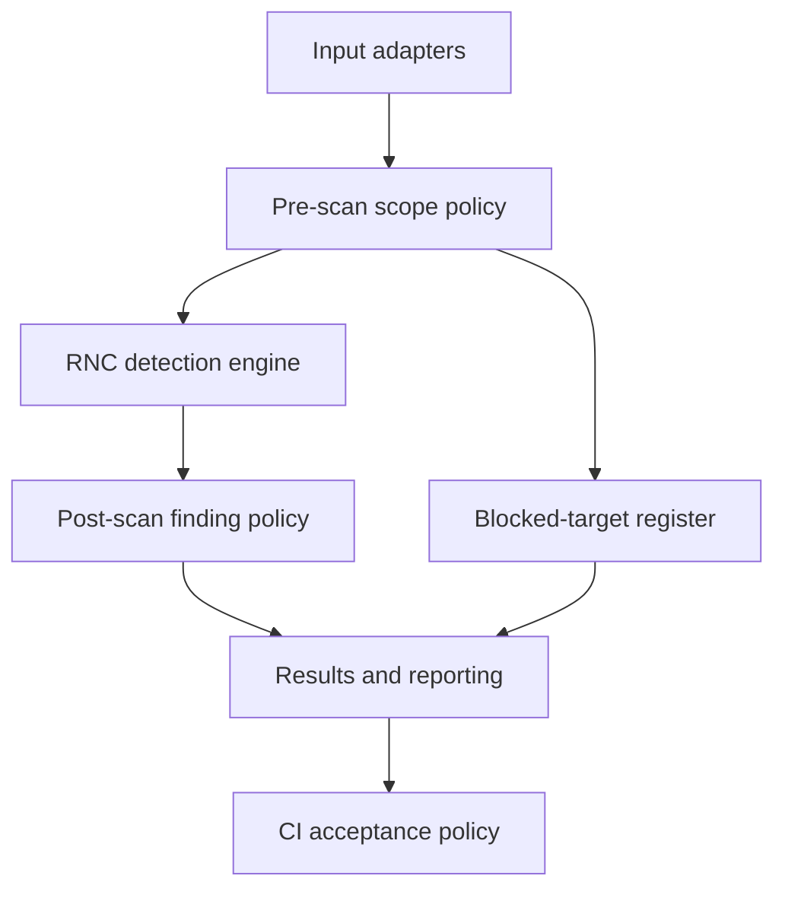

# RNC Security Audit

> **Development status — 11 November 2026:** CP0–CP2 provide a working, security-hardened Rust scanner; CP3 focuses on independent accuracy validation. The included rule bundles and passing detection scores are **synthetic test evidence**, not demonstrated real-world credential detection accuracy. No production deployment or public release is claimed.

**RNC Security Audit** is the working home for RNC's security platform. Its first-party secret-detection component is **RNC Scanner**. The wider application will eventually coordinate independent security tools as well. **RNC Security Toolkit** remains the prospective name for a portable distribution, not another codebase.

## The objective

Build a fast, accurate, testable detection engine and an accountable reporting system, then extend the system at its boundaries: source adapters and rules on the input side; verified scope policies, finding dispositions, report formats, and CI enforcement on the output side.

> **Detection establishes evidence. Policy establishes acceptable risk. Reporting establishes accountability. CI establishes enforcement.** None may silently rewrite another's record.

A scan that correctly finds a secret **succeeded at detection**; the security assessment may still require action. Likewise, a scanner that could not inspect a required target is **not clean**, even if every inspected file had zero findings.

## Product boundaries

| Component | Owns | Does not own |
| --- | --- | --- |
| **RNC Scanner — detection engine** | Matching and validation of candidate secrets against a versioned rule set; normalized, evidence-backed finding events | User exemptions, CI pass/fail decisions, presentation, harness grades |
| **Input adapters** | Deterministic acquisition/normalization of authorized files and future source types | Changing the engine's detection semantics |
| **Pre-scan scope policy** | Approved scope, verified no-read blocks, configuration provenance | Hiding files after the engine has inspected them |
| **Post-scan finding policy** | Exemptions and actionable dispositions with auditable origins | Deleting or rewriting raw detection events |
| **Reporting and status** | Reconciliation, redaction, one immutable final result classification, exports | Deciding which findings are real by changing detector output |
| **CI acceptance** | Translating final classification into process exit status | Reclassifying a scan or deleting actionable findings |
| **Independent harness** | Corpus truth, recall, precision, false positives, missed fixtures and execution correctness | Self-scoring by the production scanner |
| **Future audit orchestration** | Optional third-party security-tool adapters, readiness, authorized scanning modes and runtime selection | Claiming external findings came from RNC Scanner's first-party detector |

The first-party engine is **secret/credential detection** initially. This is not a claim to implement all of the vulnerability, dependency, container, and active-web techniques of the future toolkit inside one detector. The orchestration designs already developed remain relevant to that broader product.

## Operating contract

Every finalized scan receives **exactly one immutable result**. Numeric `result_code` values are part of the *report schema*, not operating-system process exit codes.

| Code | Result | Meaning |
| --- | --- | --- |
| `1` | `CLEAN` | Required inspection completed; no findings, applied exemptions, or verified blocks |
| `2` | `POLICY_APPLIED` | Inspection completed; verified user blocks and/or finding exemptions were applied; zero actionable findings |
| `3` | `ACTIONABLE` | Inspection completed; one or more actionable findings remain |
| `4` | `INCOMPLETE` | Execution reached a terminal point, but required targets/evidence were not fully inspected or validated |
| `5` | `FAILED` | An operational failure or interruption prevented trustworthy completion |

**Precedence:** `FAILED > INCOMPLETE > ACTIONABLE > POLICY_APPLIED > CLEAN`. A higher-priority state determines the final classification, but **never removes lower-priority evidence** from the report. An inaccessible required file plus three real findings means `INCOMPLETE`, with all three findings still accounted for. A policy-authorized, verifiably blocked target is different from an inaccessible required target.

CI decides which *completed* results are acceptable. **The approved default is `CLEAN` and `POLICY_APPLIED` (codes `1,2`)**. For example, `rnc scan ... --accept-result 1 --accept-result 2` yields process exit `0` for a final result of `POLICY_APPLIED`; narrowing to `1` rejects the identical result. `INCOMPLETE` and `FAILED` exit `20`/`30` and are never accepted. CP2 implements these semantics. See the [operator guide](docs/implementation/cp2-operator-guide.md).

The authoritative details are in the [execution-status specification](docs/architecture/execution-status.md).

## Architecture at a glance

Reporting reconciles three independently verifiable, append-only logical records: **execution**, **detection**, and **policy**. The CI acceptance decision is recorded after the immutable result is computed. Engine and rule-set versions, effective policy origin, coverage, validation, and redaction are traceable per run.

## Documents

| Start here | Why |
| --- | --- |
| [Architecture index](docs/architecture/README.md) | Four interface contracts: engine, policy, reporting, status/CI |
| [CP0 data contracts v0.2](docs/contracts/README.md) | Seven schemas, canonical identities and cross-record invariants |
| [Contract compatibility](docs/contracts/compatibility.md) | v0.1 → v0.2 changes and migration policy |
| [Harness handoff](docs/contracts/harness-handoff.md) | Tested independent-harness compatibility and outstanding integration |
| [Roadmap](docs/roadmap.md) | Capability proofs, priority, acceptance and deferred work |
| [CP0 audit report](docs/implementation/cp0-contract-validation.md) | Deliverable dispositions, evidence, limitations and readiness |
| [CP1 handoff](docs/implementation/cp1-detection-engine.md) | Rust module boundaries, rules, coverage and acceptance tests |
| [CP1 validation](docs/implementation/cp1-validation.md) | Implemented CP1 engine, tests, performance, external scoring and limitations |
| [CP2 validation](docs/implementation/cp2-validation.md) | Adaptive matching, policy, reporting, classification, benchmark and CI evidence |
| [CP2 operator guide](docs/implementation/cp2-operator-guide.md) | Build, scan, strategies, config, exemptions, reports and CI acceptance |
| [Adaptive matching](docs/architecture/adaptive-matching.md) | Backend boundaries, required literals, streaming and differential gate |
| [Source acquisition and report publication](docs/architecture/source-acquisition.md) | Root containment, discovery budgets, atomic report writes and platform guarantees |
| [Configuration](docs/architecture/configuration.md) | Global/repository/CLI precedence, mandatory caps and legacy migration |
| [Rule authoring](docs/implementation/cp1-rule-authoring.md) | Versioned data-only rule bundles and lifecycle |
| [Language ADR](docs/architecture/adr-007-detector-language.md) | Rust selection and recorded Go tradeoffs |

## Development approach

1. **CP0 — establish trustworthy contracts.** Canonical input and finding identities, synthetic truth, independent grading and the detector-language decision.
2. **CP1 — implement the first-party engine.** Rust rule evaluation, byte-accurate findings, bounded streaming and read-only acquisition.
3. **CP2 — integrate detection with control and accountability.** Portable regex/RegexSet/Aho-Corasick strategies; policy, configuration, reporting, five-state outcomes, and security hardening.
4. **CP3 — validate independently.** Strengthen the scanner-agnostic harness and measure detection correctness without allowing the production engine to grade itself.
5. **Later — broaden based on evidence.** Real credential rules, additional input adapters, controlled backend experiments and optional third-party audit orchestration.

### Current implementation

| Area | Status | Evidence |
| --- | --- | --- |
| Operating contracts (CP0) | Implemented | [CP0 audit report](docs/implementation/cp0-contract-validation.md) |
| Rust detector (CP1) | Implemented; synthetic rule bundles | [CP1 validation](docs/implementation/cp1-validation.md) |
| Adaptive matching, policies, reporting and hardening (CP2) | Implemented; CI validated | [CP2 validation](docs/implementation/cp2-validation.md) |
| Independent real-world accuracy assessment (CP3) | Development focus; not yet claimed complete | [Roadmap](docs/roadmap.md) |

The portable matching system includes a reference Rust regex strategy, a RegexSet-assisted strategy and an Aho-Corasick literal prefilter. All use the same rule, validator and finding contracts. Faster strategies are not promoted at the expense of finding equivalence.

The external scanner comparison harness is **independent test infrastructure**, not a detection dependency. Historical experiments with third-party tooling do not define the RNC Scanner engine or its results.

### Open platform-hardening work

- [#7 — Windows handle-safe directory enumeration](https://github.com/RNC-Solutions-Group/rnc-security-audit/issues/7): remove the remaining path-based discovery race.
- [#8 — Windows private-evidence ACL enforcement](https://github.com/RNC-Solutions-Group/rnc-security-audit/issues/8): apply and verify restrictive permissions rather than relying solely on inherited ACLs.
- [#9 — OS-signal cancellation](https://github.com/RNC-Solutions-Group/rnc-security-audit/issues/9): terminate scans with trustworthy execution accounting and safe cleanup.

These are tracked residual hardening requirements, **not claims that CP2 lacks source-content containment or that its CI failed**. See the [source-acquisition security design](docs/architecture/source-acquisition.md) for existing platform guarantees and limitations.

## Safety and implementation status

- No real credentials, raw secret matches, private target IDs, or machine-specific paths in this repository. Store raw evidence privately outside public source trees; sanitize before publishing.
- Verified pre-scan exclusion means source content was **not read by the detector**. Post-scan exemption means detection occurred but the finding's disposition changed. Neither may masquerade as the other.
- Target scope and active network testing require explicit authorization. Future red-team modes are separate from CI or passive source checks.
- Disabled/optional checks and unavailable **required** checks have different coverage consequences; zero inspected required targets is never `CLEAN`.
- No mandatory cloud service, GUI, database, AI summary, or auto-remediation is required for the first proof.
- Development happens on feature branches and through PRs. **The operator controls merges and deployments.** The completed development checkpoints are not, by themselves, approval for a production security release or active network testing.

### Archived design history

The [historical foundation](docs/foundation/README.md) and [original day-zero README](docs/foundation/orchestration-v0/project-readme.md) preserve the earlier third-party audit-orchestration concept. They are archives for design provenance, **not current implementation guidance or an alternate RNC Scanner product**.
