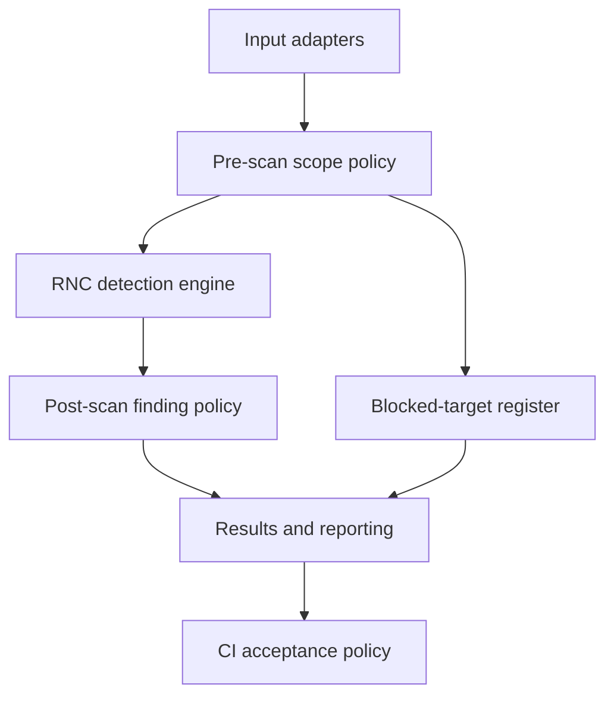

# RNC Security Audit

> **Development status - 12 November 2026:** CP0-CP2 provide a working, security-hardened Rust scanner; CP3 adds a first-party provider-credential catalog and independent byte-addressed accuracy assessment; CP4 expands generic extraction, private-key representations and provider families, and adds read-only Git-history acquisition. CP4A adds private database-password component evidence, explicit Windows private-report ACLs, retirement of internal benchmark CI and a reproducible development evaluation package. CP4B adds bounded candidate context, assignment-syntax checks, `BASE`-qualified names and context-aware hex classification. The original synthetic bundles remain preserved regression evidence, not production credential accuracy. Provider-format recognition is **not** proof that a credential is active, authorized or complete. No production deployment or public release is claimed.

**RNC Security Audit** is the working home for RNC's security platform. Its first-party secret-detection component is **RNC Scanner**. The wider application will eventually coordinate independent security tools as well. **RNC Security Toolkit** remains the prospective name for a portable distribution, not another codebase.

## The objective

Build a fast, accurate, testable detection engine and an accountable reporting system, then extend the system at its boundaries: source adapters and rules on the input side; verified scope policies, finding dispositions, report formats, and CI enforcement on the output side.

> **Detection establishes evidence. Policy establishes acceptable risk. Reporting establishes accountability. CI establishes enforcement.** None may silently rewrite another's record.

A scan that correctly finds a secret **succeeded at detection**; the security assessment may still require action. Likewise, a scanner that could not inspect a required target is **not clean**, even if every inspected file had zero findings.

## Product boundaries

| Component | Owns | Does not own |
| --- | --- | --- |
| **RNC Scanner — detection engine** | Matching and validation of candidate secrets against a versioned rule set; normalized, evidence-backed finding events | User exemptions, CI pass/fail decisions, presentation, harness grades |
| **Input adapters** | Deterministic acquisition/normalization of authorized files and future source types | Changing the engine's detection semantics |
| **Pre-scan scope policy** | Approved scope, verified no-read blocks, configuration provenance | Hiding files after the engine has inspected them |
| **Post-scan finding policy** | Exemptions and actionable dispositions with auditable origins | Deleting or rewriting raw detection events |
| **Reporting and status** | Reconciliation, redaction, one immutable final result classification, exports | Deciding which findings are real by changing detector output |
| **CI acceptance** | Translating final classification into process exit status | Reclassifying a scan or deleting actionable findings |
| **Independent harness** | Corpus truth, recall, precision, false positives, missed fixtures and execution correctness | Self-scoring by the production scanner |
| **Future audit orchestration** | Optional third-party security-tool adapters, readiness, authorized scanning modes and runtime selection | Claiming external findings came from RNC Scanner's first-party detector |

The first-party engine is **secret/credential detection** initially. This is not a claim to implement all of the vulnerability, dependency, container, and active-web techniques of the future toolkit inside one detector. The orchestration designs already developed remain relevant to that broader product.

## Operating contract

Every finalized scan receives **exactly one immutable result**. Numeric `result_code` values are part of the *report schema*, not operating-system process exit codes.

| Code | Result | Meaning |
| --- | --- | --- |
| `1` | `CLEAN` | Required inspection completed; no findings, applied exemptions, or verified blocks |
| `2` | `POLICY_APPLIED` | Inspection completed; verified user blocks and/or finding exemptions were applied; zero actionable findings |
| `3` | `ACTIONABLE` | Inspection completed; one or more actionable findings remain |
| `4` | `INCOMPLETE` | Execution reached a terminal point, but required targets/evidence were not fully inspected or validated |
| `5` | `FAILED` | An operational failure or interruption prevented trustworthy completion |

**Precedence:** `FAILED > INCOMPLETE > ACTIONABLE > POLICY_APPLIED > CLEAN`. A higher-priority state determines the final classification, but **never removes lower-priority evidence** from the report. An inaccessible required file plus three real findings means `INCOMPLETE`, with all three findings still accounted for. A policy-authorized, verifiably blocked target is different from an inaccessible required target.

CI decides which *completed* results are acceptable. **The approved default is `CLEAN` and `POLICY_APPLIED` (codes `1,2`)**. For example, `rnc scan ... --accept-result 1 --accept-result 2` yields process exit `0` for a final result of `POLICY_APPLIED`; narrowing to `1` rejects the identical result. `INCOMPLETE` and `FAILED` exit `20`/`30` and are never accepted. CP2 implements these semantics. See the [operator guide](docs/implementation/cp2-operator-guide.md).

The authoritative details are in the [execution-status specification](docs/architecture/execution-status.md).

## Architecture at a glance

Reporting reconciles three independently verifiable, append-only logical records: **execution**, **detection**, and **policy**. The CI acceptance decision is recorded after the immutable result is computed. Engine and rule-set versions, effective policy origin, coverage, validation, and redaction are traceable per run.

## Documents

| Start here | Why |
| --- | --- |
| [Architecture index](docs/architecture/README.md) | Four interface contracts: engine, policy, reporting, status/CI |
| [CP0 data contracts v0.2](docs/contracts/README.md) | Seven schemas, canonical identities and cross-record invariants |
| [Contract compatibility](docs/contracts/compatibility.md) | v0.1 → v0.2 changes and migration policy |
| [Harness handoff](docs/contracts/harness-handoff.md) | Tested independent-harness compatibility and outstanding integration |
| [Roadmap](docs/roadmap.md) | Capability proofs, priority, acceptance and deferred work |
| [CP0 audit report](docs/implementation/cp0-contract-validation.md) | Deliverable dispositions, evidence, limitations and readiness |
| [CP1 handoff](docs/implementation/cp1-detection-engine.md) | Rust module boundaries, rules, coverage and acceptance tests |
| [CP1 validation](docs/implementation/cp1-validation.md) | Implemented CP1 engine, tests, performance, external scoring and limitations |
| [CP2 validation](docs/implementation/cp2-validation.md) | Adaptive matching, policy, reporting, classification, benchmark and CI evidence |
| [CP2 operator guide](docs/implementation/cp2-operator-guide.md) | Build, scan, strategies, config, exemptions, reports and CI acceptance |
| [CP3 detection catalog](docs/implementation/cp3-detection-catalog.md) | Implemented, experimental and unsupported provider families |
| [CP3 accuracy methodology](docs/implementation/cp3-accuracy-methodology.md) | Byte truth, scoring, ambiguity, external corpora and comparative limits |
| [CP3 benchmark methodology](docs/implementation/cp3-benchmark-methodology.md) | Provider workloads, timing method, resources and limitations |
| [CP3 validation](docs/implementation/cp3-validation.md) | Final CP3 implementation, evidence, limitations and disposition |
| [CP4 detection catalog](docs/implementation/cp4-detection-catalog.md) | Expanded providers, generic extraction, private keys and unsupported families |
| [CP4 generic credentials](docs/implementation/cp4-generic-credentials.md) | Assignment formats, authorization contexts and plausible-only validation |
| [CP4 private keys](docs/implementation/cp4-private-keys.md) | PEM, escaped/base64 and PGP representations |
| [CP4 Git history](docs/implementation/cp4-git-history.md) | Read-only history scope, source identity, commands and edge behavior |
| [CP4 validation](docs/implementation/cp4-validation.md) | CP4 regression matrix, evidence, limitations and disposition |
| [CP4A hardening](docs/implementation/cp4a-hardening.md) | Structured credential evidence, Windows ACLs, CI retirement and package proof |
| [CP4B contextual validation](docs/implementation/cp4b-contextual-validation.md) | Candidate context, assignment syntax, qualified names and hex classification |
| [Adaptive matching](docs/architecture/adaptive-matching.md) | Backend boundaries, required literals, streaming and differential gate |
| [Source acquisition and report publication](docs/architecture/source-acquisition.md) | Root containment, discovery budgets, Git-history controls, atomic report writes and platform guarantees |
| [Read-only Git history ADR](docs/architecture/adr-016-read-only-git-history.md) | Process, library and security tradeoffs for the history adapter |
| [Configuration](docs/architecture/configuration.md) | Global/repository/CLI precedence, mandatory caps and legacy migration |
| [Rule authoring](docs/implementation/cp1-rule-authoring.md) | Versioned data-only rule bundles and lifecycle |
| [Language ADR](docs/architecture/adr-007-detector-language.md) | Rust selection and recorded Go tradeoffs |

## Development approach

1. **CP0 — establish trustworthy contracts.** Canonical input and finding identities, synthetic truth, independent grading and the detector-language decision.
2. **CP1 — implement the first-party engine.** Rust rule evaluation, byte-accurate findings, bounded streaming and read-only acquisition.
3. **CP2 — integrate detection with control and accountability.** Portable regex/RegexSet/Aho-Corasick strategies; policy, configuration, reporting, five-state outcomes, and security hardening.
4. **CP3 — validate independently.** Add first-party provider rules and offline validators, author independent byte truth, score exact occurrences, and record external-corpus and comparative evidence.
5. **CP4 — expand detection and acquisition.** Add generic credential extraction, private-key representations, additional documented provider families and a read-only Git-history source adapter while preserving the same detection, policy, reporting and CI contracts.
6. **Later — broaden based on evidence.** Additional source adapters, controlled backend experiments and optional third-party audit orchestration.

### Current implementation

| Area | Status | Evidence |
| --- | --- | --- |
| Operating contracts (CP0) | Implemented | [CP0 audit report](docs/implementation/cp0-contract-validation.md) |
| Rust detector (CP1) | Implemented; synthetic rule bundles | [CP1 validation](docs/implementation/cp1-validation.md) |
| Adaptive matching, policies, reporting and hardening (CP2) | Implemented; CI validated | [CP2 validation](docs/implementation/cp2-validation.md) |
| Independent accuracy assessment (CP3) | **READY FOR OPERATOR MERGE; corrective review and CI complete** | [CP3 validation](docs/implementation/cp3-validation.md), [detection catalog](docs/implementation/cp3-detection-catalog.md) |
| Detection expansion and Git history (CP4) | **READY FOR OPERATOR REVIEW; CI complete** | [CP4 validation](docs/implementation/cp4-validation.md), [catalog](docs/implementation/cp4-detection-catalog.md), [Git history](docs/implementation/cp4-git-history.md) |
| CP4A corrective hardening | **IMPLEMENTED; OPERATOR REVIEW PENDING** | [CP4A hardening](docs/implementation/cp4a-hardening.md), [package builder](tools/package/README.md) |
| CP4B contextual validation | **IMPLEMENTED; CI AND OPERATOR REVIEW PENDING** | [CP4B validation](docs/implementation/cp4b-contextual-validation.md), [generic credentials](docs/implementation/cp4-generic-credentials.md) |

The portable matching system includes a reference Rust regex strategy, a RegexSet-assisted strategy and an Aho-Corasick literal prefilter. All use the same rule, validator and finding contracts. Faster strategies are not promoted at the expense of finding equivalence.

### Provider credential catalog

CP3 established [`rules/rnc-providers-v1.json`](rules/rnc-providers-v1.json) and CP4 expands it to a schema `0.2.0` catalog with **37 rules across 22 credential families** in cloud, developer-platform, service, cryptographic, structured and generic categories. Ruleset `2026.11.5` adds bounded assignment-identifier context and updates the five generic rule families for syntax-aware validation; the database URI component extractor and every non-generic rule identity remain unchanged. It includes AWS access-key and sensitive-identifier classification, Google Cloud API keys, GitHub classic/fine-grained/OAuth and App installation tokens, GitLab PATs, Stripe, Slack, SendGrid, npm, Azure Storage, Tailscale, Groq, xAI, Perplexity, Doppler, OpenAI, Slack webhooks, PEM/PGP private-key representations, Bearer JWTs, database URI userinfo and contextual generic extraction. Ordinary IAM resource identifiers such as `AIDA` and `AROA` are not treated as access keys.

Every rule has a finite match bound and declared candidate bound. Validators are offline: no provider API is called, no token is redeemed and no discovered credential is sent over a network. Structural validity is not active-credential verification. The [CP4 detection catalog](docs/implementation/cp4-detection-catalog.md) distinguishes implemented, experimental and unsupported families; the CP3 catalog is preserved as historical evidence.

Generic assignments, Basic/Bearer authorization headers, URL userinfo, escaped/base64-wrapped private keys and PGP armor are implemented with bounded context and structural validation. Generic assignment rules retain exact full-match/identifier context for syntax gating and context-aware hex classification; context is never serialized. Generic values remain `PLAUSIBLE_UNVERIFIED`; a parseable value is not promoted to a confirmed credential. See [CP4B contextual validation](docs/implementation/cp4b-contextual-validation.md).

For database URI findings, the primary finding remains the contextual `username:password` userinfo. Private reports additionally carry a versioned `structured_evidence` section with the password's original byte range and SHA-256 digests. Supported ANSI SGR decoration is normalized for the normalized digest without changing source coordinates; unsupported escapes receive no component evidence. The section is omitted from sanitized output and console summaries. See [CP4A hardening](docs/implementation/cp4a-hardening.md).

### Git-history scanning

`rnc scan --history --root <repository>` performs read-only acquisition of
reachable commits, first-parent changed content and original blob bytes. It does
not check out revisions, modify the index, run hooks, fetch, traverse submodules,
or scan reflogs/unreachable objects. Historical findings are attributed to
`commit/<oid>/<path>` units and keep byte-accurate source positions. See the
[Git-history guide](docs/implementation/cp4-git-history.md) and
[ADR-016](docs/architecture/adr-016-read-only-git-history.md). A history scan is
explicit; a working-tree scan does not become a history scan because `.git`
exists.

The independent scenario suite scores exact byte spans rather than lines. On the controlled Tier 2, held-out Tier 3 and hand-authored Tier 4 challenge corpora all four strategies in whole-file and streaming modes produce the same findings: **27/27**, **15/15** and **14/14**. The validation report records the exact recall/precision, the corrected one-to-one Gitleaks reconciliation and the deliberate limitations. Tier 2/3 share a generator; Tier 4 is independently authored but still first-party, not an externally sourced corpus. External Levain, Leaky Repo and pinned Gitleaks evidence is scoped in the [accuracy methodology](docs/implementation/cp3-accuracy-methodology.md); it is not converted into a universal product score.

The external scanner comparison harness is **independent test infrastructure**, not a detection dependency. Historical experiments with third-party tooling do not define the RNC Scanner engine or its results.

### Open platform-hardening work

- [#7 — Windows handle-safe directory enumeration](https://github.com/RNC-Solutions-Group/rnc-security-audit/issues/7): remove the remaining path-based discovery race.
- [#8 — Windows private-evidence ACL enforcement](https://github.com/RNC-Solutions-Group/rnc-security-audit/issues/8): CP4A now creates private report files with an explicit protected DACL, verifies it on the open handle before payload writes, and tests replacement on a deliberately permissive parent. Operator issue closure remains pending after review.
- [#9 — OS-signal cancellation](https://github.com/RNC-Solutions-Group/rnc-security-audit/issues/9): terminate scans with trustworthy execution accounting and safe cleanup.

Issues #7 and #9 remain tracked residual hardening requirements; #8 has an implemented CP4A mitigation pending operator closure. These are **not claims that CP2 lacks source-content containment or that its CI failed**. See the [source-acquisition security design](docs/architecture/source-acquisition.md) for existing platform guarantees and limitations.

## Safety and implementation status

- No real credentials, raw secret matches, private target IDs, or machine-specific paths in this repository. Provider fixtures are deterministic synthetic values; the PEM fixtures are deliberately inconsistent and not usable keys. Store raw evidence privately outside public source trees; sanitize before publishing.
- Provider-format detection is not proof of an active, authorized, complete or non-revoked credential. JWTs are reported only with an explicit Bearer context; generic assignments and opaque authorization values are plausible-only; public keys, certificates and PGP public armor are not private keys. Git-history acquisition is read-only and explicitly selected; shallow, partial, corrupt or alternate-object histories fail closed rather than being reported clean.
- Verified pre-scan exclusion means source content was **not read by the detector**. Post-scan exemption means detection occurred but the finding's disposition changed. Neither may masquerade as the other.
- Target scope and active network testing require explicit authorization. Future red-team modes are separate from CI or passive source checks.
- Disabled/optional checks and unavailable **required** checks have different coverage consequences; zero inspected required targets is never `CLEAN`.
- No mandatory cloud service, GUI, database, AI summary, or auto-remediation is required for the first proof.
- Development happens on feature branches and through PRs. **The operator controls merges and deployments.** The completed development checkpoints are not, by themselves, approval for a production security release or active network testing.

### Archived design history

The [historical foundation](docs/foundation/README.md) and [original day-zero README](docs/foundation/orchestration-v0/project-readme.md) preserve the earlier third-party audit-orchestration concept. They are archives for design provenance, **not current implementation guidance or an alternate RNC Scanner product**.
