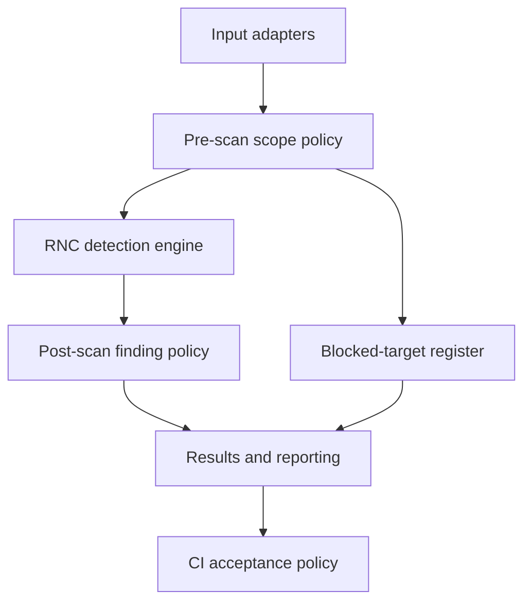

# RNC Security Audit

> **CP0 audit package — contracts, synthetic truth and language selection (10 November 2026).** No RNC production detection engine, working CLI, security assessment, or release is claimed by this repository. CP1 remains gated on operator acceptance.

**RNC Security Audit** is the working home for RNC's security platform. Its first-party secret-detection component is **RNC Scanner**. The wider application will eventually coordinate independent security tools as well. **RNC Security Toolkit** remains the prospective name for a portable distribution, not another codebase.

## The objective

Build a fast, accurate, testable detection engine and an accountable reporting system, then extend the system at its boundaries: source adapters and rules on the input side; verified scope policies, finding dispositions, report formats, and CI enforcement on the output side.

> **Detection establishes evidence. Policy establishes acceptable risk. Reporting establishes accountability. CI establishes enforcement.** None may silently rewrite another's record.

A scan that correctly finds a secret **succeeded at detection**; the security assessment may still require action. Likewise, a scanner that could not inspect a required target is **not clean**, even if every inspected file had zero findings.

## Product boundaries

| Component | Owns | Does not own |
| --- | --- | --- |
| **RNC Scanner — detection engine** | Matching and validation of candidate secrets against a versioned rule set; normalized, evidence-backed finding events | User exemptions, CI pass/fail decisions, presentation, harness grades |
| **Input adapters** | Deterministic acquisition/normalization of authorized files and future source types | Changing the engine's detection semantics |
| **Pre-scan scope policy** | Approved scope, verified no-read blocks, configuration provenance | Hiding files after the engine has inspected them |
| **Post-scan finding policy** | Exemptions and actionable dispositions with auditable origins | Deleting or rewriting raw detection events |
| **Reporting and status** | Reconciliation, redaction, one immutable final result classification, exports | Deciding which findings are real by changing detector output |
| **CI acceptance** | Translating final classification into process exit status | Reclassifying a scan or deleting actionable findings |
| **Independent harness** | Corpus truth, recall, precision, false positives, missed fixtures and execution correctness | Self-scoring by the production scanner |
| **Security Audit orchestration** | Other scanners (Gitleaks, Trivy, Semgrep, ZAP, etc.), per-scanner readiness, runtime backends and authorized modes | Claiming that third-party adapter output came from RNC's own detector |

The first-party engine is **secret/credential detection** initially. This is not a claim to implement all of the vulnerability, dependency, container, and active-web techniques of the future toolkit inside one detector. The orchestration designs already developed remain relevant to that broader product.

## Operating contract

Every finalized scan receives **exactly one immutable result**. Numeric `result_code` values are part of the *report schema*, not operating-system process exit codes.

| Code | Result | Meaning |
| --- | --- | --- |
| `1` | `CLEAN` | Required inspection completed; no findings, applied exemptions, or verified blocks |
| `2` | `POLICY_APPLIED` | Inspection completed; verified user blocks and/or finding exemptions were applied; zero actionable findings |
| `3` | `ACTIONABLE` | Inspection completed; one or more actionable findings remain |
| `4` | `INCOMPLETE` | Execution reached a terminal point, but required targets/evidence were not fully inspected or validated |
| `5` | `FAILED` | An operational failure or interruption prevented trustworthy completion |

**Precedence:** `FAILED > INCOMPLETE > ACTIONABLE > POLICY_APPLIED > CLEAN`. A higher-priority state determines the final classification, but **never removes lower-priority evidence** from the report. An inaccessible required file plus three real findings means `INCOMPLETE`, with all three findings still accounted for. A policy-authorized, verifiably blocked target is different from an inaccessible required target.

CI decides which *completed* results are acceptable. **The approved default is `CLEAN` and `POLICY_APPLIED` (codes `1,2`)**. For example, the proposed `rnc scan . --accept-results 1,2` yields process exit `0` for a final result of `POLICY_APPLIED`; `--accept-results 1` rejects the identical result. `INCOMPLETE` and `FAILED` remain nonzero in the initial contract. These are **proposed commands, not implemented functionality**.

The authoritative details are in the [execution-status specification](docs/architecture/execution-status.md).

## Architecture at a glance

Reporting reconciles three independently verifiable, append-only logical records: **execution**, **detection**, and **policy**. The CI acceptance decision is recorded after the immutable result is computed. Engine and rule-set versions, effective policy origin, coverage, validation, and redaction are traceable per run.

## Documents

| Start here | Why |
| --- | --- |
| [Architecture index](docs/architecture/README.md) | Four interface contracts: engine, policy, reporting, status/CI |
| [CP0 data contracts v0.2](docs/contracts/README.md) | Seven schemas, canonical identities and cross-record invariants |
| [Contract compatibility](docs/contracts/compatibility.md) | v0.1 → v0.2 changes and migration policy |
| [Harness handoff](docs/contracts/harness-handoff.md) | Tested independent-harness compatibility and outstanding integration |
| [Roadmap](docs/roadmap.md) | Capability proofs, priority, acceptance and deferred work |
| [CP0 audit report](docs/implementation/cp0-contract-validation.md) | Deliverable dispositions, evidence, limitations and readiness |
| [CP1 handoff](docs/implementation/cp1-detection-engine.md) | Rust module boundaries, rules, coverage and acceptance tests |
| [Language ADR](docs/architecture/adr-007-detector-language.md) | Rust selection and recorded Go tradeoffs |
| [Historical foundation](docs/foundation/README.md) | Preserved original orchestration concept, workflows, bypass-report sketches and first Gitleaks proof |

## Development approach

1. **Freeze interfaces and synthetic truth cases** before production detector work.
2. **Build the RNC Scanner engine first**: deterministic input, rule evaluation, normalized immutable detection events, baseline performance and provenance.
3. **Build accountable reporting second** with policy, reconciliation, five results, redaction and CI acceptance wired through explicit contracts.
4. **Validate independently** using a scanner-agnostic harness and known fixtures, then broaden rules and input adapters.
5. **Reuse the original audit orchestration** when integrating third-party security tools, execution backends, and passive/active modes.

The current Gitleaks modernization and independent scan-harness projects are valuable **comparators and test infrastructure**, not a dependency for designing the RNC engine and not a reason to copy its limitations.

**CP0 outcomes (10 November 2026):** contract revision `0.2.0` fixes impossible-result and coverage-accounting defects; the authored corpus expanded to 21 targets/26 markers/25 expected findings plus generated 1,000-target and large/oversize edge corpora; an independent synthetic harness grades controlled stub scenarios at **100%**; the pinned external harness scoring engine accepted the handoff; representative equivalent Go/Rust benchmarks selected **Rust** for the CP1 detector; and all three required CI lanes passed in [run 42905445240](https://github.com/RNC-Solutions-Group/rnc-security-audit/actions/runs/42905445240), with Go tradeoffs preserved. Default CI acceptance remains `1,2`. [Decision register](docs/architecture/decisions.md) · [CP0 report](docs/implementation/cp0-contract-validation.md) · [ADR-007](docs/architecture/adr-007-detector-language.md).

## Safety and implementation status

- No real credentials, raw secret matches, private target IDs, or machine-specific paths in this repository. Store raw evidence privately outside public source trees; sanitize before publishing.
- Verified pre-scan exclusion means source content was **not read by the detector**. Post-scan exemption means detection occurred but the finding's disposition changed. Neither may masquerade as the other.
- Target scope and active network testing require explicit authorization. Future red-team modes are separate from CI or passive source checks.
- Disabled/optional checks and unavailable **required** checks have different coverage consequences; zero inspected required targets is never `CLEAN`.
- No mandatory cloud service, GUI, database, AI summary, or auto-remediation is required for the first proof.
- Development happens on feature branches and through PRs. **The operator merges**; the CP0 audit does not implement the production scanner, merge a PR, or authorize active tests.

For historical context, the [original day-zero README](docs/foundation/orchestration-v0/project-readme.md) is preserved byte-for-byte. It described an orchestrator **without** a first-party detection engine; that is now a historical design, not the governing architecture.
